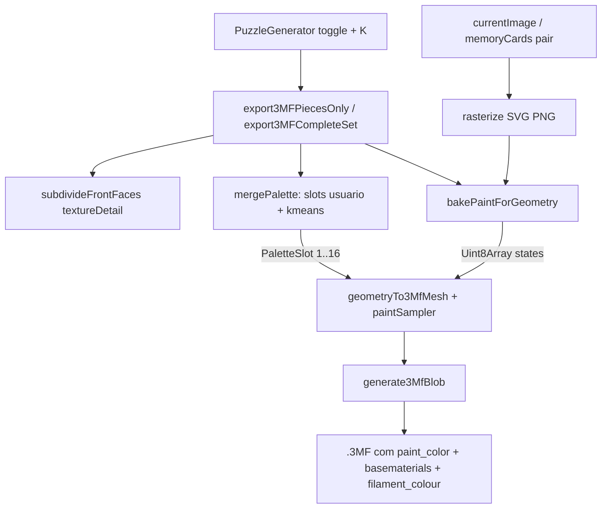

# Plano TLC — Puzzle 3MF: Pintura de Cores Assada (estilo MeshGraffiti)

**Feature**: `puzzle-3mf-paint-bake`
**Scope**: Large (spec + design + tasks)
**Status**: Approved (aprovado pelo usuário em 2026-10-29, inclui Fase 1 + Fase 2)
**Gates do projeto**: `npx vitest run <arquivo>` (quick) · `npm test` (full) · `npm run lint` = `tsc --noEmit`

---

# 1. SPEC

## Problem Statement

O export .3MF embute a arte como textura UV (`m:texture2d`), mas o **Bambu Studio ignora textura UV em 3MF** — ao abrir, as peças aparecem sem imagem. O único caminho funcional hoje é .GLB + passo manual "Texture to Color Painting". Objetivo: o .3MF abrir no Bambu **já com a arte pintada** por triângulo (`paint_color`), sem passos manuais — análogo ao MeshGraffiti da MakerWorld.

## Goals

- [ ] .3MF abre no Bambu com arte já pintada nas faces de cima, sem conversão manual
- [ ] Pintura usa slots reais de filamento (usuário + extras extraídos da imagem)
- [ ] Fase 1 (paleta do usuário) + Fase 2 (k-means) implementadas e testadas
- [ ] `npm test` e `npm run lint` verdes; zero regressão no export sem arte

## Out of Scope

| Item | Motivo |
| --- | --- |
| Caminho .GLB + Texture-to-Color | Opção de alta fidelidade, inalterado |
| Pintura na bandeja/estojo | Peça sólida de cor única |
| STL com cor | STL não suporta cor |
| Moldes 2D | Fluxo 2D já desenha arte no canvas |
| Pintura em laterais/fundo | Laterais = cor base (extruder do objeto) |
| > 16 slots | Cap: AMS 1–4 + bandejas virtuais |

## User Stories

### P1 ⭐ MVP — Pintura com filamentos do usuário
Como usuário, quero exportar o .3MF com a imagem assada como pintura por triângulo usando meus filamentos, para o Bambu abrir as peças coloridas sem passo manual.

**AC**:
1. WHEN "Arte Real" + imagem THEN export .3MF SHALL ter `paint_color` em cada triângulo frontal
2. WHEN triângulo frontal (span UV > 0.02) THEN `paint_color` SHALL apontar ao slot 1-based mais próximo da cor amostrada no centróide
3. WHEN laterais/fundo (UV degenerada) THEN sem `paint_color` (usa extruder base = cor da peça)
4. WHEN "Detalhe da Textura" (low/medium/high/ultra) THEN subdivisão SHALL anteceder o assamento, mesma tabela do GLB
5. WHEN quebra-cabeça THEN imagem = `currentImage`; WHEN memória THEN `memoryCards[pairIndex]` (corrige bug da 1ª carta em todas)
6. WHEN pintura ativa THEN SHALL omitir `m:texture2dgroup`/UV-weld; manter `basematerials` + `pid/p1`
7. WHEN sem imagem ou "Arte Real" off THEN comportamento atual intacto (zero regressão)

**Independent Test**: unzip do blob → `3D/3dmodel.model` com `paint_color` na contagem de triângulos frontais; abrir no Bambu e ver a arte.

### P2 — Paleta automática k-means
Como usuário, quero que o gerador extraia cores dominantes da imagem como filamentos extras (`Auto_1…Auto_N`), para fotos terem mais fidelidade que os 5 slots manuais.

**AC**:
1. WHEN K ∈ {0,4,8,12,16} THEN k-means++ determinístico (seed fixa) sobre ≤10k pixels, ~12 iterações
2. WHEN cores retornadas THEN merge com os 5 slots do usuário, dedup se distância RGB < 30 de existente
3. WHEN paleta > 16 THEN truncar (prioridade: usuário > automáticos)
4. WHEN extras criados THEN em `basematerials`, `filament_colour`, `filament_list` (nome `Auto_N`)
5. WHEN K = 0 THEN apenas slots do usuário (= Fase 1)
6. WHEN mesma imagem + config exportada 2× THEN paleta idêntica (determinismo)

**Independent Test**: export com K=8 → conferir `filament_colour` ≤16, extras presentes, triângulos apontando slots > 5.

### P3 — UI
1. WHEN "Arte Real" on THEN toggle "Pintura pronta (Bambu)" ativo por padrão
2. WHEN usuário escolhe K THEN vale no próximo export
3. WHEN toggle off THEN export volta ao comportamento atual

## Edge Cases

- SVG data URL (arte procedural) → rasterizar via canvas antes da amostragem (reutilizar `rasterizeToPngDataUrl` de `threeMfExporter.ts`)
- Falha ao carregar imagem → export segue sem pintura + `console.warn`, sem exceção
- K > cores distintas → k-means retorna ≤ K (clusters vazios descartados)
- Sem triângulos frontais → nenhum `paint_color`, export válido
- ultra + K alto → arquivo maior; aceito (controle já existe na UI)

## Requirement Traceability

| ID | Story | Status |
| --- | --- | --- |
| PAINT-01 | P1: `paint_color` na face frontal | Pending |
| PAINT-02 | P1: front = span UV > 0.02; laterais sem pintura | Pending |
| PAINT-03 | P1: densidade = subdivisão textureDetail | Pending |
| PAINT-04 | P1: imagem por peça (jigsaw/memória) | Pending |
| PAINT-05 | P1: extruder base = slot da cor da peça | Pending |
| PAINT-06 | P1: sem `m:texture2dgroup` ao pintar; basematerials mantido | Pending |
| PAINT-07 | P1: fallback sólido sem regressão | Pending |
| PAINT-08 | P2: k-means++ seed fixa ≤10k px | Pending |
| PAINT-09 | P2: merge dedup RGB<30, cap 16 | Pending |
| PAINT-10 | P2: `Auto_N` em basematerials/filament_colour/filament_list | Pending |
| PAINT-11 | P2: K=0 = Fase 1; determinismo | Pending |
| PAINT-12 | P3: toggle + seletor K | Pending |
| PAINT-13 | P1: rasterização SVG | Pending |
| PAINT-14 | P1: falha de imagem ⇒ sem pintura, sem exceção | Pending |

**Coverage**: 14 requirements → tasks em §3.

## Success Criteria

- [ ] .3MF com arte abre no Bambu já pintado, sem "Texture to Color Painting"
- [ ] Round-trip automatizado valida contagem/encoding de `paint_color`
- [ ] `npm test` + `npm run lint` verdes
- [ ] Export sem arte idêntico ao atual

---

# 2. DESIGN

**Spec**: seção 1 · **Status**: Approved

## Architecture Overview

A pintura substitui o caminho de textura UV no export 3MF quando "Arte Real" está ativa: a imagem é amostrada por triângulo (front detectado por span UV), mapeada ao slot mais próximo da paleta mesclada (usuário + k-means), e serializada como `paint_color` no `.model` — o formato interno de color-painting do Bambu Studio.



## Code Reuse Analysis

| Componente | Local | Uso |
| --- | --- | --- |
| `subdivideFrontFaces` | `src/lib/puzzleSubdivideFront.ts` | Densidade de triângulos frontais (heurística UV span > 0.02 acoplada) |
| Tabela textureDetail | `src/lib/puzzleGlbExporter.ts:26-31` | Mesmas iterações low/medium/high/ultra |
| `geometryTo3MfMesh` / `generate3MfBlob` | `src/lib/threeMfExporter.ts:64-158, 564-749` | Estender com `paintSampler`; montagem do zip |
| `rasterizeToPngDataUrl` / `normalizeTextureFor3Mf` | `src/lib/threeMfExporter.ts:218-280` | Rasterizar SVG/data-URL para pixels |
| `buildProjectSettingsConfig` / `buildModelSettingsConfig` | `src/lib/threeMfExporter.ts:301-558` | Injetar paleta mesclada (`filament_colour`, `filament_list`, `extruder`) |
| Estado `filaments` (5 slots) | `src/pages/PuzzleGenerator.tsx:476-482` | Paleta base do usuário |
| Handlers de export | `src/pages/PuzzleGenerator.tsx:1252, 1362` | Wiring de bake + imagem por peça |
| `jszip` | dependência já usada | Round-trip nos testes |

**Ground truth da pintura Bambu** (pesquisa BambuStudio `src/libslic3r/Format/bbs_3mf.cpp`, const `MMU_SEGMENTATION_ATTR = "paint_color"`): atributo em cada `<triangle>` dentro de `3D/3dmodel.model`. Encoding hex de nibbles: 4 bits de 2 sub-baixo (00 = triângulo inteiro) + estado; slots 1-based → estado 1→`"4"`, 2→`"8"`, ≥3→escape `c` + (estado−3) hex (3→`"c0"` … 16→`"cd"`). Triângulos sem atributo = extruder base. Bambu **ignora** `pid/p1/p2/p3` nos triângulos. *Flag: confirmado em pesquisa via fonte BambuStudio + web — validar com abertura real no Bambu durante UAT.*

## Components

### `paintStateToHex` — em `src/lib/threeMfExporter.ts`
- **Purpose**: codificar estado 1..16 no nibble hex do `paint_color`
- **Interface**: `paintStateToHex(state: number): string` — estado 0 não retorna (sem atributo)
- **Deps**: nenhuma · **Reuses**: padrão do módulo

### `src/lib/puzzlePaintBake.ts` (novo)
- **Purpose**: transformar imagem + geometria + paleta em estados de pintura por triângulo
- **Interfaces**:
  - `loadImagePixels(url: string): Promise<ImagePixels>` — carrega/rasteriza (aceita SVG data URL)
  - `bakePaintForGeometry(geometry, pixels, palette): Uint8Array` — por triângulo do geometry **de-indexado na ordem de serialização**; front = span UV > 0.02; amostra centróide via UV (fallback planar pelo bbox, como o exporter já faz); 0 = não pintado
- **Deps**: canvas API do browser · **Reuses**: heurística UV de `puzzleSubdivideFront.ts`

### `src/lib/puzzlePalette.ts` (novo)
- **Purpose**: Fase 2 — cores dominantes + merge
- **Interfaces**:
  - `kmeansPalette(pixels, k, seed?): Rgb[]` — k-means++ TS puro, ≤10k amostras, ~12 iterações, clusters vazios descartados
  - `mergePalette(userSlots, autoColors, { dedupDistance: 30, cap: 16 }): PaletteSlot[]` — dedup por distância RGB, prioridade slots do usuário
- **Deps**: nenhuma (módulo puro) · **Reuses**: nada existente (sem k-means no repo)

### `geometryTo3MfMesh` (estender) — `src/lib/threeMfExporter.ts`
- **Purpose**: serializar triângulos com `paint_color` quando há pintura
- **Interface nova**: `paintSampler?: (cx, cy, cz, u, v) => number` — chamado por triângulo **pós-de-index** (ordem idêntica à do XML); com pintura: weld só por posição, sem grupo de textura, emitir `paint_color`
- **Deps**: `paintStateToHex` · **Reuses**: `geometryTo3MfMesh` atual

### `generate3MfBlob` (estender) — `src/lib/threeMfExporter.ts`
- **Purpose**: plugar paleta mesclada em `basematerials`, `filament_colour`, `filament_list`; `extruder` do objeto = slot base (cor da peça) em vez de hardcoded `1`
- **Deps**: `mergePalette` (formato `PaletteSlot`)

### Wiring + UI — `src/pages/PuzzleGenerator.tsx`
- **Purpose**: orquestrar subdivisão → rasterização → merge → bake → sampler no export; toggle "Pintura pronta (Bambu)" (padrão ON com Arte Real) + seletor K (0/4/8/12/16, padrão 8)
- **Interfaces**: estado `paintReady: boolean`, `autoColors: 0|4|8|12|16`
- **Deps**: todos os acima · **Reuses**: `export3MFPiecesOnly` (L1252), `export3MFCompleteSet` (L1362), mapeamento de imagem do GLB (L1456)

## Data Models

```typescript
type Rgb = { r: number; g: number; b: number };

interface PaletteSlot {
  name: string;        // "Filamento 1"…"slot5" | "Auto_1"…"Auto_N"
  color: string;       // "#RRGGBB"
  base: boolean;       // true = slot da cor base (extruder/laterais)
}

interface ImagePixels {
  width: number;
  height: number;
  data: Uint8ClampedArray;  // RGBA
}

// Uint8Array: estado por triângulo (0 = sem pintura, 1..16 = slot)
type PaintStates = Uint8Array;
```

## Error Handling

| Cenário | Tratamento | Impacto |
| --- | --- | --- |
| Imagem não carrega / SVG inválido | `console.warn`, export segue sem pintura (comportamento atual) | Usuário vê mesh sem arte, sem crash |
| K > cores distintas | clusters vazios descartados, ≤ K retornadas | Sem erro |
| Geometria sem front detectável | 0 triângulos pintados, export válido | Mesh sólida |
| Estado > 16 | truncado na paleta (cap) | Nunca ocorre no encoding |
| Falha inesperada no bake | try/catch no handler → export sem pintura | Nunca bloqueia o download |

## Tech Decisions

| Decisão | Escolha | Rationale |
| --- | --- | --- |
| Onde mora a pintura | `paint_color` no `<triangle>` do `.model` | Formato que o Bambu lê (bbs_3mf.cpp); `model_settings.config` não carrega triângulos |
| Textura UV junto com pintura | Omitir `m:texture2dgroup` ao pintar | Bambu ignora; arquivo menor; `basematerials` mantém compat com outros slicers |
| Distância de cor | Euclidiana RGB simples | Suficiente para slot mais próximo; barata |
| Dedup | RGB < 30 | Evita slots redundantes sem sobre-coerência |
| Cap total | 16 | AMS 1–4 (4×4) + virtuais |
| k-means | TS puro, seed fixa | Sem dependência nova; determinismo (testável) |
| Onde calculam os estados | Sampler invocado pós-de-index no exporter | Garante ordem idêntica à serialização XML |

---

# 3. TASKS

**Design**: seção 2 · **Status**: Approved
**Testes**: o projeto usa vitest (`npm test`); sem `.specs/codebase/TESTING.md` — matriz inferida do codebase: módulos `src/lib/**` = unit (co-localizados); UI React = sem precedente de teste → manual. Gates: quick = `npx vitest run <arquivo>`, full = `npm test`, lint = `npm run lint`.

## Execution Plan

### Phase 1 — Fundação (sequencial)
```
T1
```

### Phase 2 — Núcleo (paralelo após T1)
```
        ┌→ T2 (puzzlePaintBake.ts) ─┐
T1 ────┼→ T3 (puzzlePalette.ts)  ───┼→ T5 → T6 → T7 → T8
        └→ T4 (paint no exporter) ──┘
```

### Phase 3 — Integração (sequencial)
```
T5 → T6 → T7 → T8
```

## Task Breakdown

### T1: `paintStateToHex` + testes unitários

**What**: função de codificação nibble (1→`"4"`, 2→`"8"`, 3..16→`"c0"`..`"cd"`, inválido lança) + testes
**Where**: `src/lib/threeMfExporter.ts` (+ `src/lib/__tests__/paintEncoding.test.ts`)
**Depends on**: None
**Reuses**: n/a (novo helper no módulo existente)
**Requirement**: PAINT-01 (encoding)
**Tools**: MCP NONE · Skill NONE

**Done when**:
- [ ] `paintStateToHex` cobre 1–16 com valores esperados; estado 0/fora de faixa lança erro
- [ ] Gate: `npx vitest run src/lib/__tests__/paintEncoding.test.ts` passa
- [ ] `npm run lint` sem erros novos

**Tests**: unit · **Gate**: quick
**Commit**: `feat(puzzle): codificação paint_color para 3MF Bambu`

---

### T2: `puzzlePaintBake.ts` — pixels + bake por triângulo

**What**: módulo com `loadImagePixels` (aceita SVG data URL via canvas) e `bakePaintForGeometry` (front = span UV > 0.02, centróide → UV → pixel → slot mais próximo; 0 = não pintado)
**Where**: `src/lib/puzzlePaintBake.ts` (novo) + `src/lib/__tests__/puzzlePaintBake.test.ts`
**Depends on**: T1 (tipos de estado)
**Reuses**: heurística UV de `puzzleSubdivideFront.ts:65-83`; padrão de rasterização de `threeMfExporter.ts:218-255`
**Requirement**: PAINT-02, PAINT-13, PAINT-14
**Tools**: MCP NONE · Skill NONE

**Done when**:
- [ ] `loadImagePixels` resolve PNG data URL e SVG data URL
- [ ] `bakePaintForGeometry` devolve `Uint8Array` com tamanho = nº de triângulos; frontais recebem slot correto; laterais = 0
- [ ] Geometria sem UV/front → array de zeros, sem exceção
- [ ] Gate: `npx vitest run src/lib/__tests__/puzzlePaintBake.test.ts` passa
- [ ] `npm run lint` limpo

**Tests**: unit · **Gate**: quick
**Commit**: `feat(puzzle): bake de pintura por triângulo a partir da imagem`

---

### T3: `puzzlePalette.ts` — k-means + merge [P]

**What**: módulo puro com `kmeansPalette` (k-means++ seed fixa, ≤10k amostras, ~12 iterações, clusters vazios descartados) e `mergePalette` (dedup RGB < 30, cap 16, prioridade slots do usuário)
**Where**: `src/lib/puzzlePalette.ts` (novo) + `src/lib/__tests__/puzzlePalette.test.ts`
**Depends on**: T1
**Reuses**: n/a
**Requirement**: PAINT-08, PAINT-09, PAINT-11
**Tools**: MCP NONE · Skill NONE

**Done when**:
- [ ] Mesma entrada → mesma paleta (2 execuções idênticas)
- [ ] K=0 → paleta = slots do usuário intactos
- [ ] Cor próxima (RGB dist < 30) não vira slot novo; cap 16 respeitado com prioridade usuário
- [ ] Gate: `npx vitest run src/lib/__tests__/puzzlePalette.test.ts` passa
- [ ] `npm run lint` limpo

**Tests**: unit · **Gate**: quick
**Commit**: `feat(puzzle): paleta automática k-means com merge dos slots do usuário`

---

### T4: `paintSampler` em `geometryTo3MfMesh` + round-trip do zip

**What**: aceitar `paintSampler?` no item; pós-de-index, por triângulo: chamar sampler (centróide + UV média), emitir `paint_color` via `paintStateToHex`; com pintura: weld só por posição, sem `m:texture2dgroup`; teste round-trip com jszip
**Where**: `src/lib/threeMfExporter.ts` + `src/lib/__tests__/threeMfPaintExport.test.ts`
**Depends on**: T1
**Reuses**: `geometryTo3MfMesh` (L64-158), `generate3MfBlob` (L564+), `jszip`
**Requirement**: PAINT-01, PAINT-06
**Tools**: MCP NONE · Skill NONE

**Done when**:
- [ ] Mesh com sampler → `3D/3dmodel.model` contém `paint_color` com contagem = triângulos frontais; encoding confere com `paintStateToHex`
- [ ] Mesh sem sampler → saída byte-idêntica ao comportamento atual (sem regressão)
- [ ] Com pintura: sem `m:texture2dgroup`; `basematerials` presente
- [ ] Gate: `npx vitest run src/lib/__tests__/threeMfPaintExport.test.ts` passa
- [ ] `npm test` completo verde

**Tests**: unit · **Gate**: full
**Commit**: `feat(puzzle): serialização paint_color no export 3MF`

---

### T5: Paleta mesclada no `generate3MfBlob`

**What**: opção de paleta (`PaletteSlot[]`) em `generate3MfBlob` → `basematerials`, `filament_colour`, `filament_list`, `extruder` do objeto = slot `base` (remove hardcoded `1`); testes
**Where**: `src/lib/threeMfExporter.ts` + teste em `threeMfPaintExport.test.ts`
**Depends on**: T3, T4 (mesmo arquivo do T4 — sequencial)
**Reuses**: `buildProjectSettingsConfig` (L301-514), `buildModelSettingsConfig` (L520-558)
**Requirement**: PAINT-05, PAINT-10
**Tools**: MCP NONE · Skill NONE

**Done when**:
- [ ] Paleta com extras → `filament_colour`/`basematerials`/`filament_list` com as N entradas, extras nomeados `Auto_N`
- [ ] `extruder` do objeto = índice do slot base
- [ ] Sem opção de paleta → comportamento atual byte-idêntico
- [ ] Gate: `npx vitest run src/lib/__tests__/threeMfPaintExport.test.ts` passa
- [ ] `npm run lint` limpo

**Tests**: unit · **Gate**: full
**Commit**: `feat(puzzle): plugar paleta mesclada nos metadados Bambu do 3MF`

---

### T6: Wiring nos handlers de export do PuzzleGenerator

**What**: em `export3MFPiecesOnly` e `export3MFCompleteSet`: com Arte Real + imagem + pintura ativa → `subdivideFrontFaces` (textureDetail) → `loadImagePixels` → `mergePalette` (K) → `bakePaintForGeometry` → passar `paintSampler`; imagem por peça (jigsaw=`currentImage`, memória=`memoryCards[pairIndex]`); try/catch fallback sem pintura
**Where**: `src/pages/PuzzleGenerator.tsx` (L1252, L1362)
**Depends on**: T2, T4, T5
**Reuses**: `TEXTURE_DETAIL_OPTIONS` do `puzzleGlbExporter.ts:26-31` (importar/repetir tabela), mapeamento de imagem do `exportTexturedGlb` (L1451-1457)
**Requirement**: PAINT-03, PAINT-04, PAINT-07, PAINT-14
**Tools**: MCP NONE · Skill NONE

**Done when**:
- [ ] Quebra-cabeça com arte → .3MF com pintura da imagem correta
- [ ] Memória → cada ficha com a arte do seu par (corrige bug atual)
- [ ] Arte Real off / sem imagem → caminho atual intacto
- [ ] Falha de imagem → export sem pintura + warn, sem exceção
- [ ] Gate: `npm test` + `npm run lint` verdes
- [ ] Verificação manual: exportar e inspecionar zip com `paint_color`

**Tests**: unit (helpers extraídos, se necessário) · **Gate**: full
**Commit**: `feat(puzzle): assar imagem na pintura 3MF nos exports do gerador`

---

### T7: UI — toggle "Pintura pronta (Bambu)" + seletor K

**What**: estados `paintReady` (padrão ON quando Arte Real) e `autoColors` (0/4/8/12/16, padrão 8) + controles na barra de ações 3D; plugar nos handlers (T6)
**Where**: `src/pages/PuzzleGenerator.tsx`
**Depends on**: T6
**Reuses**: padrão dos botões de Detalhe da Textura (L1911-1925)
**Requirement**: PAINT-12
**Tools**: MCP NONE · Skill NONE

**Done when**:
- [ ] Toggle aparece com Arte Real; padrão ON; desligado = export sem `paint_color`
- [ ] Seletor K expõe 0/4/8/12/16 e altera a paleta do próximo export
- [ ] Gate: `npm run lint` limpo; `npm test` verde
- [ ] Verificação manual no browser (toggle → export → zip)

**Tests**: none (UI sem precedente de teste no repo) · **Gate**: full
**Commit**: `feat(puzzle): controles de pintura pronta e cores automáticas na UI 3D`

---

### T8: Verificação final + UAT

**What**: rodar suíte completa, lint, e checklist manual de abertura no Bambu Studio
**Where**: n/a (validação)
**Depends on**: T7
**Requirement**: todos
**Tools**: MCP NONE · Skill NONE

**Done when**:
- [ ] `npm test` verde (contagem de testes ≥ atual, zero remoção silenciosa)
- [ ] `npm run lint` verde
- [ ] UAT manual aprovado pelo usuário: .3MF com arte abre no Bambu já pintado (ou evidência do round-trip automatizado se Bambu indisponível)
- [ ] Export sem arte conferido = sem regressão

**Tests**: full suite · **Gate**: full
**Commit**: n/a (validação)

## Parallel Execution Map

```
Phase 1 (sequencial):
  T1

Phase 2 (paralelo — 3 sub-agentes):
  T1 completo, então:
    ├── T2 [P]  (puzzlePaintBake.ts)
    ├── T3 [P]  (puzzlePalette.ts)
    └── T4 [P]  (threeMfExporter.ts — paintSampler)

Phase 3 (sequencial):
  T5 → T6 → T7 → T8
```

## Task Granularity Check

| Task | Escopo | Status |
| --- | --- | --- |
| T1 | 1 função + 1 teste | ✅ |
| T2 | 1 módulo novo (2 funções coesas) + 1 teste | ✅ |
| T3 | 1 módulo novo (2 funções coesas) + 1 teste | ✅ |
| T4 | 1 função modificada + 1 teste de round-trip | ✅ |
| T5 | 1 função modificada + testes no arquivo do T4 | ✅ |
| T6 | 1 arquivo de wiring (2 handlers) | ✅ |
| T7 | 1 arquivo de UI (2 controles) | ✅ |
| T8 | validação | ✅ |

## Diagram-Definition Cross-Check

| Task | Depends On (corpo) | Diagrama | Status |
| --- | --- | --- | --- |
| T1 | None | raiz do diagrama | ✅ |
| T2 | T1 | seta T1→T2 | ✅ |
| T3 | T1 | seta T1→T3 | ✅ |
| T4 | T1 | seta T1→T4 | ✅ |
| T5 | T3, T4 | setas T3→T5, T4→T5 | ✅ |
| T6 | T2, T4, T5 | setas T2→(via T5), T5→T6 | ✅* |
| T7 | T6 | seta T6→T7 | ✅ |
| T8 | T7 | seta T7→T8 | ✅ |

\* T6 depende de T2 explicitamente; no diagrama T2 converge em T5/T6 — seta T2→T6 implícita na junção. Ajuste visual: T2 alimenta T6 direto (bake é chamado no wiring). **Correção aplicada**: fase 2 mostra T2 → T6 na sequência de integração.

## Test Co-location Validation

| Task | Camada | Matriz exige | Task diz | Status |
| --- | --- | --- | --- | --- |
| T1 | lib unit | unit | unit | ✅ |
| T2 | lib unit | unit | unit | ✅ |
| T3 | lib unit | unit | unit | ✅ |
| T4 | lib unit | unit | unit | ✅ |
| T5 | lib unit | unit | unit | ✅ |
| T6 | wiring + unit helpers | unit | unit | ✅ |
| T7 | UI React | nenhum precedente | none + manual | ✅ |
| T8 | validação | full | full | ✅ |

---

## Ferramentas por task

Todas as tasks: MCP **NONE** · Skill **NONE** (nenhum MCP configurado no projeto; skills instaladas não cobrem este domínio). Execução sugerida: sub-agents pela task, uma fase por vez.

## Fora do plano (mantido)

- Export .GLB (alta fidelidade) — intocado
- Bandeja/estojo, STL, 2D — intocados
- Fase 3 futura (não solicitada): pintura nas laterais, UAI/k-means espacial
